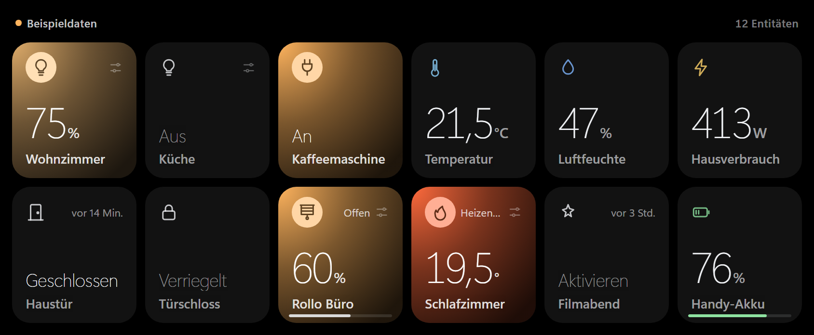
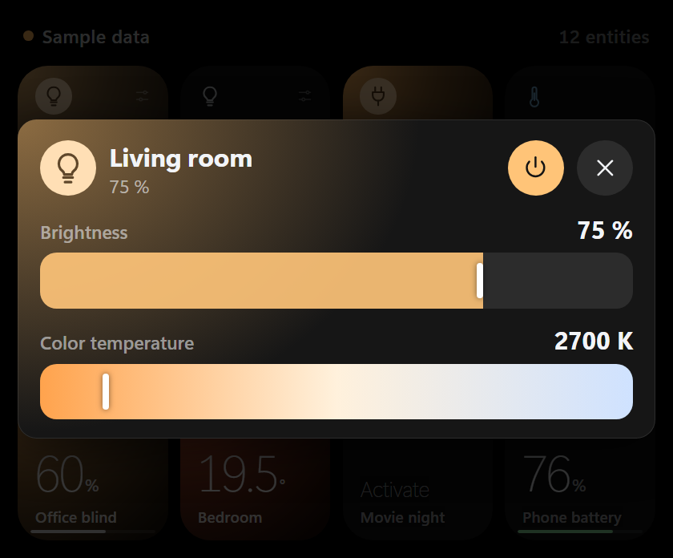
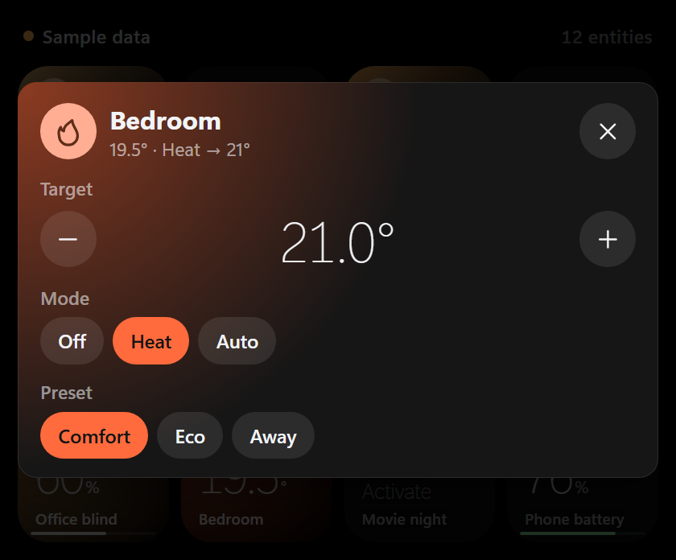

# Homedeck Edge

**Dein Home Assistant auf der CORSAIR Xeneon Edge** – deine eigenen Entitäten als Live-Kacheln. Lampen lassen ihre Kachel in ihrer echten Farbe leuchten, Heizungen glühen orange, Sensoren zeigen ihre Einheit. Antippen schaltet, langes Drücken dimmt Lampen oder stellt die Heizung ein.

[English](README.md)

**[⬇ Neueste Version herunterladen](https://github.com/KaelanTesseract/homedeck-edge/releases/latest)** · [Projektseite](https://dennis-guse.de/projekte/homedeck-edge.html)

## Funktionen

- **Beliebige Entitäten** aus deinem Home Assistant, in der Reihenfolge, in der du sie einträgst
- **Live-Aktualisierung** über die WebSocket-API von Home Assistant – ohne CORS-Einstellung auf dem Server
- **Leucht-Design:** Eine eingeschaltete Lampe lässt ihre Kachel in ihrer echten Farbe leuchten, gedimmt leuchtet sie schwächer. Heizen glüht orange mit Flamme, Kühlen blau mit Schneeflocke, Sensoren haben farbige Symbole
- **Antippen** schaltet Lampen, Schalter, Lüfter, Rollos, Schlösser, Szenen, Skripte und Buttons
- **Langes Drücken** öffnet das Bedienfeld:

  | Entität | Regler |
  |---|---|
  | Lampe | Helligkeit, Farbtemperatur, An/Aus |
  | Heizung, Warmwasser | Soll-Temperatur (− / +), Modus, Voreinstellung |
  | Rollo | Position, Öffnen / Stopp / Schließen |
  | Lüfter | Stufe, Voreinstellungen |
  | Mediaplayer | Lautstärke, Zurück / Play-Pause / Weiter |
  | `input_number`, `number` | Wert |

- Türen, Fenster und Bewegungsmelder zeigen, wie lange der letzte Wechsel her ist
- Falsch geschriebene Entitäts-IDs erscheinen als rote Kachel **NICHT GEFUNDEN**, statt einfach zu fehlen
- **Offline:** Die letzten Werte bleiben ausgegraut stehen, das Widget verbindet sich von selbst neu
- Alle 8 Größen der Xeneon Edge, quer und hochkant – das Raster wählt die passende Spaltenzahl
- Deutsch und Englisch

| Lampe | Heizung |
|---|---|
|  |  |

## Voraussetzungen

- Windows, iCUE 5.52 oder neuer, CORSAIR Xeneon Edge
- Home Assistant, vom PC aus erreichbar, und ein langlebiges Zugriffstoken

## Installation

1. Lade `Homedeck-x.y.z.icuewidget` aus den Releases herunter.
2. Doppelklick auf die Datei – iCUE öffnet sich und importiert das Widget. Erlaube den Netzwerkzugriff, wenn iCUE fragt.
3. Öffne in Home Assistant dein **Profil → Sicherheit → Langlebige Zugriffstokens → Token erstellen** und kopiere das Token.
4. Zieh **Homedeck** auf eine Seite deiner Xeneon Edge und fülle die Einstellungen aus:
   - **Home-Assistant-Adresse**, z. B. `http://192.168.1.20:8123` (`https://` geht auch)
   - **Langlebiges Zugriffstoken** aus Schritt 3
   - **Entitäts-IDs**, durch Komma getrennt, z. B. `light.kueche, sensor.wohnzimmer_temperatur, climate.bad`

## Einstellungen

| Einstellung | Standard |
|---|---|
| Home-Assistant-Adresse | `http://homeassistant.local:8123` |
| Langlebiges Zugriffstoken | – |
| Entitäts-IDs (durch Komma getrennt) | – |
| Touch-Bedienung | an (aus = nur Anzeige, kein Schalten, kein Bedienfeld) |
| Verbindungsleiste | an |
| Widget-Personalisierung | Textfarbe, Akzentfarbe (`#ffb45e`), Hintergrund (`#000000`), Hintergrundbild, Helligkeit, Unschärfe, Transparenz |

## Datenschutz und Berechtigungen

| Berechtigung | Bereich | Wozu |
|---|---|---|
| Netzwerk | jeder Host | verbindet sich mit der Home-Assistant-Adresse, die du einträgst |
| Netzwerk | `localhost:8123` | für Home Assistant auf demselben PC |

Homedeck spricht nur mit deinem eigenen Home-Assistant-Server – keine anderen Server, kein Tracking. Das Token bleibt in den iCUE-Widget-Einstellungen auf deinem PC.

## Entwicklung

Siehe [README.md](README.md#development).

## Lizenz

MIT – siehe [LICENSE](LICENSE).
