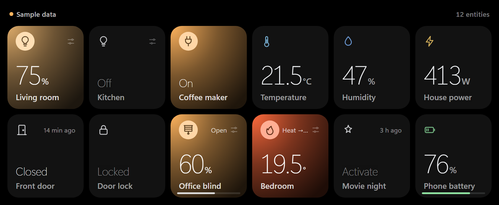
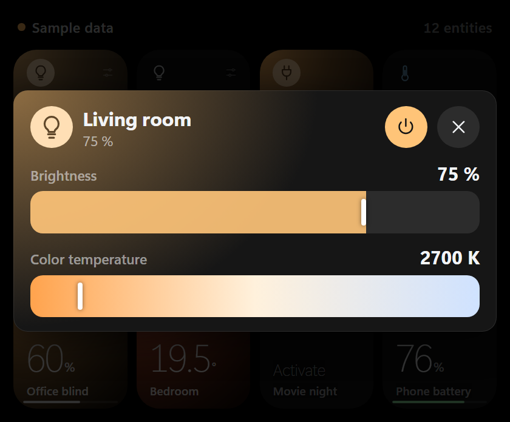
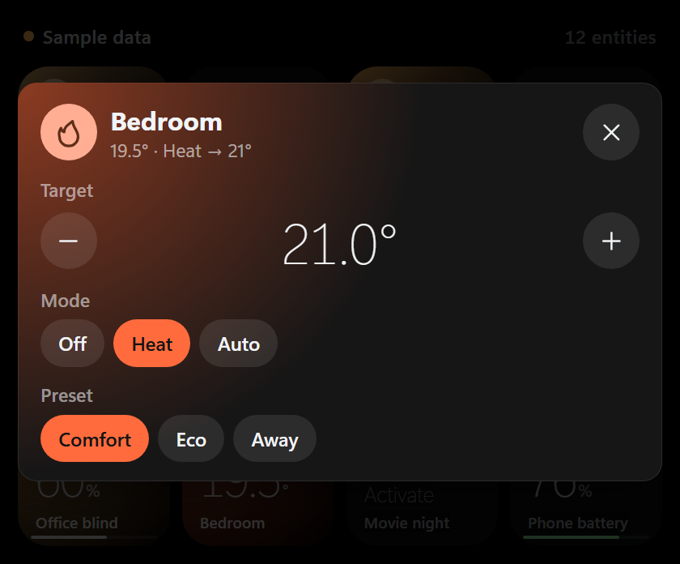

# Homedeck Edge

**Your Home Assistant on the CORSAIR Xeneon Edge** – your own entities as live tiles. Lamps light their tile in their real colour, heating glows orange, sensors show their units. Tap to switch, long-press to dim lights or set the heating.

[Deutsch](README.de.md)



**[⬇ Download the latest version](https://github.com/KaelanTesseract/homedeck-edge/releases/latest)**

## Features

- **Any entities** from your Home Assistant, in the order you list them
- **Live updates** over the Home Assistant WebSocket API – no CORS settings needed on your server
- **Glow design:** a switched-on lamp lights its tile in its real colour, a dimmed lamp glows less; heating glows orange with a flame, cooling blue with a snowflake; sensors get coloured icons
- **Tap** to toggle lights, switches, fans, covers, locks, scenes, scripts and buttons
- **Long-press** for the control panel:

  | Entity | Controls |
  |---|---|
  | Light | brightness, colour temperature, on/off |
  | Climate, water heater | target temperature (− / +), mode, preset |
  | Cover | position, open / stop / close |
  | Fan | speed, presets |
  | Media player | volume, previous / play-pause / next |
  | `input_number`, `number` | value |

- Doors, windows and motion sensors show how long ago they changed
- Mistyped entity IDs show as red **NOT FOUND** tiles instead of disappearing
- **Offline:** keeps the last values, greys them out and reconnects on its own
- All 8 Xeneon Edge sizes, horizontal and vertical – the grid picks the best number of columns
- English and German

| Light | Heating |
|---|---|
|  |  |

## Requirements

- Windows, iCUE 5.52 or newer, CORSAIR Xeneon Edge
- Home Assistant reachable from your PC, and a long-lived access token

## Install

1. Download `Homedeck-x.y.z.icuewidget` from the releases.
2. Double-click it – iCUE opens and imports the widget. Allow the network access when iCUE asks.
3. In Home Assistant open your **profile → Security → Long-lived access tokens → Create token** and copy the token.
4. Add **Homedeck** to a page of your Xeneon Edge and fill in its settings:
   - **Home Assistant address**, e.g. `http://192.168.1.20:8123` (`https://` works too)
   - **Long-lived access token** from step 3
   - **Entity IDs**, comma-separated, e.g. `light.kitchen, sensor.living_room_temperature, climate.bathroom`

## Settings

| Setting | Default |
|---|---|
| Home Assistant address | `http://homeassistant.local:8123` |
| Long-lived access token | – |
| Entity IDs (comma-separated) | – |
| Touch control | on (off = display only, no switching, no control panel) |
| Connection status bar | on |
| Widget personalization | text colour, accent colour (`#ffb45e`), background (`#000000`), background image, brightness, blur, transparency |

## Privacy and permissions

| Permission | Scope | Why |
|---|---|---|
| Network | any host | connects to the Home Assistant address you enter |
| Network | `localhost:8123` | for Home Assistant on the same PC |

Homedeck talks only to your own Home Assistant server – no other servers, no tracking. The token stays in the iCUE widget settings on your PC.

## Development

```bash
python -m http.server 5523 --bind 127.0.0.1 --directory widget
```

Open `http://127.0.0.1:5523/` – outside iCUE the widget shows sample data.

- `#lang=de` German, `#count=4` fewer tiles, `#missing` a NOT FOUND tile, `#setup` the setup screen, `#panel=climate.bedroom` opens a control panel
- `#url=http://ha:8123&token=…&entities=light.a,sensor.b` connects to a real server (the hash never leaves your PC)
- `python tools/shots.py docs/images --readme` renders the README images with headless Edge (`pip install websockets pillow`)
- `icuewidget validate widget` / `icuewidget package widget` (needs `npm install -g icuewidget-cli`)
- Tags `v*` build a draft release with the package and `SHA256SUMS.txt`

## License

MIT – see [LICENSE](LICENSE).
